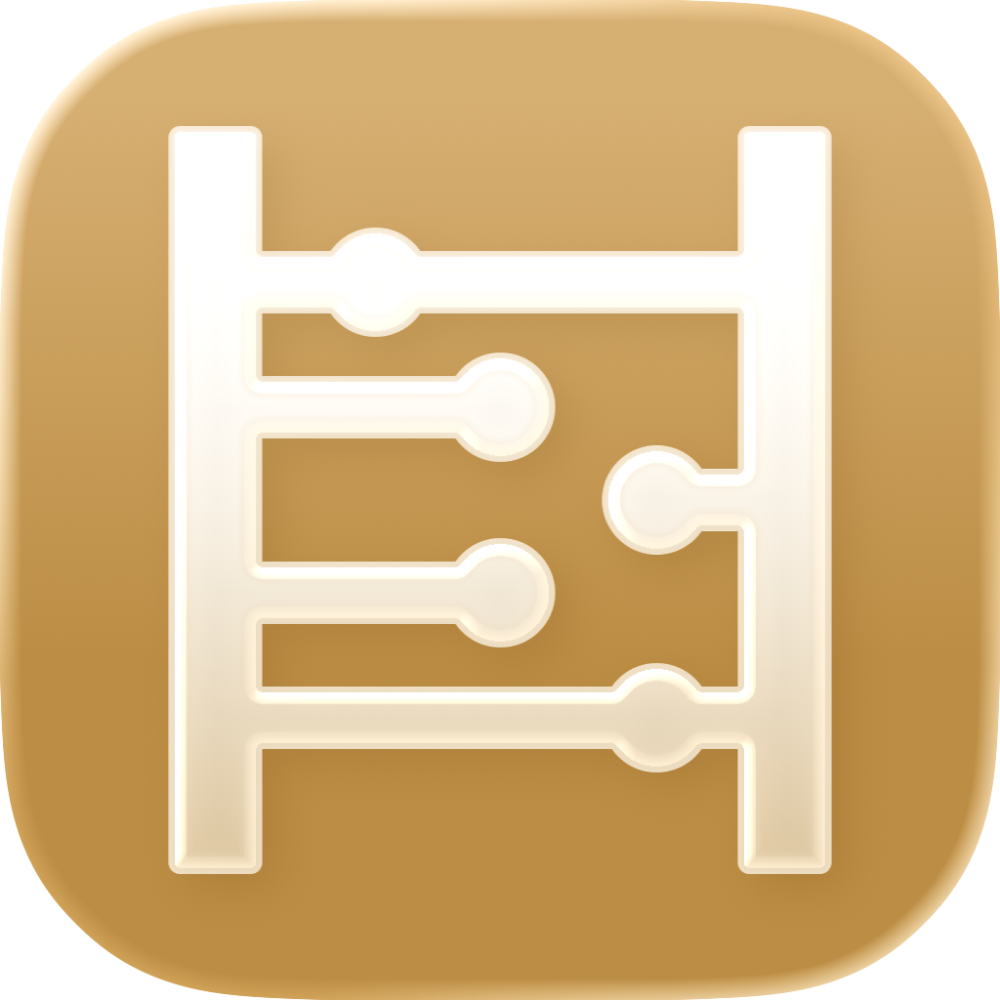
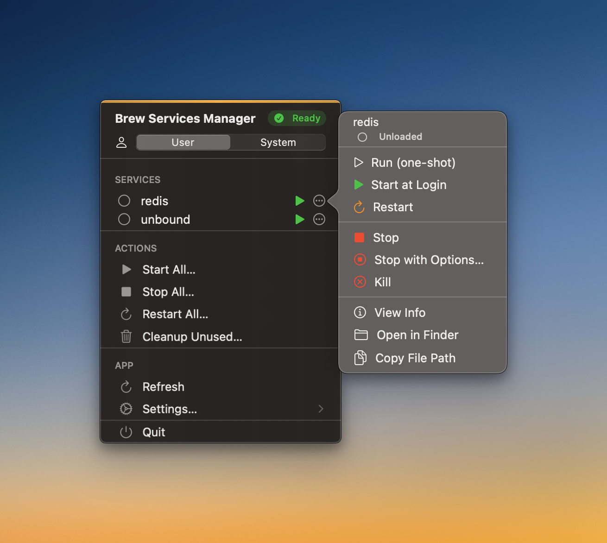

# Brew Services Manager

<p align="center">
  
</p>

<p align="center">
  <strong>A macOS menu bar app for managing Homebrew services</strong>
</p>

<p align="center">
  
  
  
  
</p>

---

## Screenshot

<p align="center">
  
</p>

---

## Overview

A macOS menu bar app for managing Homebrew services. Start, stop, and restart services without the terminal.

### Features

- Lists every `brew services` entry with its status, and refreshes on a schedule you choose
- Start, stop, restart, run, or kill a service, or act on all of them at once
- Shows the ports a running service listens on, including ports opened by its child processes
- Saves links to a service's web interface, such as `http://localhost:8384` for Syncthing
- Manages user services and system (root) services; system actions ask for your administrator password
- Can launch at login and check for updates
- Debug mode shows the full Homebrew output when something fails

---

## Requirements

- **macOS 15.0** (Sequoia) or later
- **Homebrew** installed and configured
- Services installed via Homebrew (e.g., `brew install postgresql`, `brew install redis`)

---

## Installation

### Option 1: Install via Homebrew

```bash
brew install --cask validatedev/tap/brew-services-manager
```

### Option 2: Download Pre-built Release

1. Download the latest `.dmg` from the [Releases](https://github.com/validatedev/BrewServicesManager/releases) page
2. Open the DMG and drag **Brew Services Manager** to your Applications folder
3. Launch the app from Applications or Spotlight

### Option 3: Build from Source

1. Clone the repository:
   ```bash
   git clone https://github.com/validatedev/BrewServicesManager.git
   cd BrewServicesManager
   ```

2. Open the project in Xcode:
   ```bash
   open BrewServicesManager.xcodeproj
   ```

3. **Configure Code Signing** (first time only):
   ```bash
   # Copy the development config template
   cp Config/Development.shared.xcconfig Config/Development.xcconfig

   # Edit the file and replace YOUR_TEAM_ID with your Apple Developer Team ID
   # You can find your Team ID at: https://developer.apple.com/account
   # OR in Xcode: Settings → Accounts → [Your Account] → Team ID
   nano Config/Development.xcconfig
   ```

4. Build and run (⌘R) or archive for distribution (Product → Archive)

---

## Usage

### Getting Started

1. Launch the app. It runs only in the menu bar, as a mug icon.
2. Click the icon to see your Homebrew services and their status.
3. Each service row has a **Start** or **Stop** button for the common case.
4. The **More Actions** (⋯) button opens the rest: Run (one-shot), Start at Login, Restart, Stop with Options…, Kill, Manage Links…, View Info, Open in Finder, and Copy File Path.

### Port Detection

When you open **More Actions** or **View Info** for a running service, the app looks up the ports that the service and its child processes listen on. This covers services that spawn workers, such as Syncthing and nginx.

- **More Actions** shows the first three ports, for example `8384, 22000`.
- **View Info** lists every port with its protocol (TCP or UDP).

### Service Links

Add custom URLs to quickly access service web interfaces:

1. Click **More Actions** (⋯) on a service and choose **Manage Links…**
2. Add a link:
   - Click a suggested URL (built from the detected ports), or
   - Click **Add Custom Link** and enter any URL
   - Optionally give it a label, such as "Admin Panel" or "Metrics"
3. The first two links appear as buttons on the service row. All of them are listed under **More Actions**.

**Examples:**
- Syncthing → `http://localhost:8384` (Web UI)
- Local API → `http://localhost:3000` (Development server)
- nginx → `http://localhost:80` (Web server)

Links are saved automatically and persist across app restarts.

### Service Domains

Brew Services Manager supports two service domains:

| Domain | Description | Privileges |
|--------|-------------|------------|
| **User** | Services running under your user account | Standard user permissions |
| **System** | System-wide services (root-level) | Requires administrator password |

Switch domains with the selector in the menu header, or in **Settings → Domain**.


### Global Actions

Perform bulk operations on all services:

- **Start All**: start every service and register it to run at login
- **Stop All**: stop every running service
- **Restart All**: restart every service
- **Cleanup**: remove unused service files

### Settings

Open **Settings…** from the menu:

- **Domain**: User or System
- **Run system services as**: the user passed to `--sudo-service-user` for system services; leave it empty for root
- **Auto-refresh**: Disabled, 30 seconds, 1 minute, or 5 minutes
- **Launch at login**: start the app when you log in to macOS
- **Automatically check for updates**, plus a **Check for Updates…** button
- **Debug mode**: show detailed Homebrew output

---


## Building & Development

### Prerequisites

- Xcode 26.0 or later
- macOS 15.0 or later (for running)
- Homebrew (for testing service management)
- Apple Developer account (free or paid, for code signing)

### Code Signing Setup

Before building, you need to configure code signing:

1. Open the project in Xcode
2. Select **BrewServicesManager** project → **BrewServicesManager** target
3. Go to **Signing & Capabilities**
4. Select your team from the dropdown

The project does not include a hardcoded development team, allowing each contributor to use their own Apple Developer account.

### Build Commands

```bash
# Build for development
xcodebuild -scheme BrewServicesManager -configuration Debug build

# Build for release  
xcodebuild -scheme BrewServicesManager -configuration Release build

# Run tests
xcodebuild -scheme BrewServicesManager test
```

---

## Troubleshooting

### Common Issues

<details>
<summary><strong>Brew Services Manager can't find Homebrew</strong></summary>

Ensure Homebrew is installed and accessible:
```bash
# Check if brew is in PATH
which brew

# If using Apple Silicon, ensure /opt/homebrew/bin is in PATH
echo $PATH
```

Brew Services Manager searches for Homebrew in:
- `/opt/homebrew/bin/brew` (Apple Silicon)
- `/usr/local/bin/brew` (Intel)

</details>

<details>
<summary><strong>Services show "Error" status</strong></summary>

1. Open **More Actions** (⋯) on the service and choose **View Info**
2. Check the error message and exit code
3. Enable **Debug Mode** in Settings for verbose output
4. Verify the service plist is valid:
   ```bash
   brew services info <service-name>
   ```

</details>

<details>
<summary><strong>Port detection not showing any ports</strong></summary>

Port detection only works for **running** services. Ensure:
1. The service is actually running (status shows "started")
2. The service is listening on TCP/UDP ports
3. You have the necessary permissions to run `lsof`

To verify manually:
```bash
# Check if service is listening
lsof -nP -iTCP -sTCP:LISTEN | grep <service-name>
```

</details>

<details>
<summary><strong>System authentication dialog appears but can't be clicked</strong></summary>

This issue has been fixed in recent versions. If you encounter this:
1. Update to the latest version of Brew Services Manager
2. The authentication dialog should now accept mouse input properly
3. If issues persist, you can still use keyboard navigation (Tab to move between fields, Space/Enter to click buttons)

</details>

---

## License

This project is licensed under the MIT License — see the [LICENSE](LICENSE) file for details.

---

## Acknowledgments

- [Homebrew](https://brew.sh/) — The missing package manager for macOS
- [SF Symbols](https://developer.apple.com/sf-symbols/) — Apple's iconography system
- [SwiftAgents](https://github.com/twostraws/SwiftAgents) - Base `AGENTS.md` file for best practices

---

<p align="center">
  Made with 🦆
</p>
